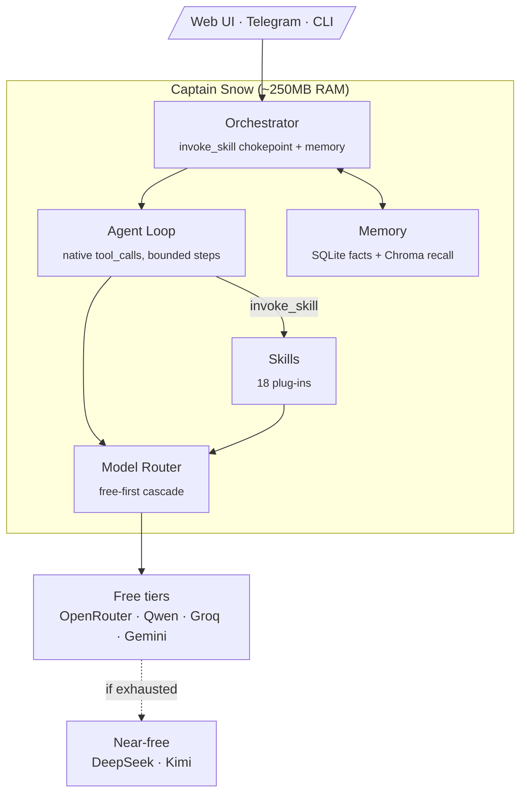

<div align="center">


# Captain Snow

Captain Snow is a lightweight, resource-efficient AI agent designed to run on low-power devices with minimal memory overhead (under 300 MB). It solves the problem of high computational and API costs typically associated with AI agents by routing requests through a prioritized cascade of free-tier cloud LLMs (such as OpenRouter, Qwen, Groq, and Gemini). This approach avoids the need for heavy local models or expensive paid APIs while maintaining high-quality reasoning capabilities.

**Main Stack:** Python 3.12+, Docker, SQLite, and Chroma.

**How to run (Docker):**
```bash
git clone https://github.com/DGFcorporations/captain-snow-oss.git
cd captain-snow-oss
cp .env.example .env        # Add your free API keys
docker compose up -d
```

**Key Features:**
- **Multiple Interfaces:** Web UI, Telegram bot, and CLI sharing unified memory.
- **Web Capabilities:** Automated browsing via Playwright, web search, and SEO auditing.
- **Workflow Automation:** Multi-step planning, email operations, and integrations with Stripe, Airtable, and Google Workspace.
- **Extensible Architecture:** Add custom skills via a simple Python plugin system.

[](LICENSE)
[](https://www.python.org/)
[](Dockerfile)
[](../../actions)
[](CONTRIBUTING.md)

[Quick Start](#quick-start) •
[Skills](#skills) •
[Architecture](#architecture) •
[Security](#security-by-default) •
[Testing & Evals](#testing--evals) •
[Contributing](#contributing)

</div>

---

## Why Captain Snow?

Most self-hosted AI agents require choosing between high-resource local setups or expensive API dependencies:

| | Heavy local agents | API-first agents | **Captain Snow** |
|---|---|---|---|
| **RAM at idle** | 4–16 GB | 1–2 GB | **~200–300 MB** |
| **Disk** | 5–40 GB (models) | 1–3 GB | **< 1 GB** |
| **Cost per month** | Hardware costs | $20–200+ API | **$0*** |
| **Model quality** | 7B–13B local | GPT-4-class | **70B-class (free tiers)** |
| **Hardware** | Server/Desktop | Server | **Phone / Raspberry Pi** |

<sub>*Routes through free-tier cloud providers (Groq, Gemini, OpenRouter, Qwen). Near-free paid fallbacks (DeepSeek, Kimi) can be enabled.</sub>

Captain Snow ships no model. Every request cascades through a prioritized chain of free-tier cloud LLMs, providing strong reasoning capabilities while the hardware runs a lightweight asynchronous Python process. If free tiers are unavailable, it falls through to near-free paid tiers.

```text
request ──▶ free tiers (OpenRouter → Qwen → Groq → Gemini) ──▶ near-free (DeepSeek → Kimi)
```

The system includes a health-check command (`captainsnow doctor --ping`) to verify configured providers and handle deprecated model slugs by automatically falling through to the next provider.

## Key Capabilities

- **Unified Chat:** Web UI, Telegram bot, and CLI interfaces utilizing a shared context.
- **Persistent Memory:** Long-term facts persist in SQLite and Chroma, consolidating nightly.
- **Web Search & SEO:** DuckDuckGo integration (Serper optional) and technical SEO reports.
- **Automated Browsing:** Playwright-driven navigation, scraping, and form filling.
- **Multi-step Planning:** Decomposes complex goals into executable steps.
- **Stripe Integration:** Manage customers, charges, and balances.
- **Email Operations:** Send and read email via IMAP/SMTP.
- **Database & Workspace Integration:** Support for Airtable, Supabase (SQL), and Google Workspace (Sheets, Docs, Drive).
- **Content Publishing:** Drafts to WordPress and Ghost via REST APIs.
- **Route Optimization:** Google Maps-powered routing.
- **Proactive Monitoring:** Uptime checks and data watchers with Telegram alerts.

Skills are implemented as plugins and can be disabled in `config.yaml`.

## Quick Start

An API key is required. Free keys are available from [OpenRouter](https://openrouter.ai/keys) or [Groq](https://console.groq.com/keys).

### Docker (recommended)

```bash
git clone https://github.com/DGFcorporations/captain-snow-oss.git
cd captain-snow-oss
cp .env.example .env        # paste your key(s) into .env
docker compose up -d
```

Open `http://localhost:8000` to access the Web UI.

### Bare Python

```bash
git clone https://github.com/DGFcorporations/captain-snow-oss.git
cd captain-snow-oss
cp config.example.yaml config.yaml
pip install -e .
export OPENROUTER_API_KEY=sk-or-...
captainsnow chat "hello"
```

### Telegram

Set these three variables to use the Telegram bot:

```bash
TELEGRAM_BOT_TOKEN=...   # from @BotFather
TELEGRAM_OWNER_ID=...    # send /start to @userinfobot to get yours
TELEGRAM_CHAT_ID=...     # usually the same as owner id
```

> ⚠️ Without `TELEGRAM_OWNER_ID`, the bot ignores all messages for security purposes. See [Security by Default](#security-by-default).

## Skills

| Skill | Description |
|---|---|
| `search` | Web search (DuckDuckGo free, Serper optional) |
| `seo_core` | Full SEO audits: meta, schema, social tags, content quality, keywords |
| `browser` | Playwright browsing: navigate, scrape, forms, screenshots |
| `megaplan` | Multi-phase execution: contract → verified steps → bounded re-plan |
| `content` | Blog/social drafting and WordPress/Ghost publishing |
| `email_ops` | Send and read email |
| `stripe` | Payments, customers, balances |
| `airtable` | CRUD on Airtable bases |
| `supabase_connector` | Supabase/SQL queries |
| `google_workspace` | Sheets, Docs, Drive |
| `route_optimizer` | Optimized multi-stop routes |
| `watchers` | Uptime and data monitoring with Telegram alerts |
| `revenue_consultant` | Revenue/MRR analysis |
| `fileops` | Local file read/write/move |
| `github_ops` | GitHub repository operations via PyGithub |
| `file_gen` | Document generation (DOCX, PDF) |
| `agent_overseer` | Delegation and oversight across skills |

To add a custom skill, subclass `Skill`, implement `async def execute(self, task) -> str`, and register the name.

## Architecture



The model emits native `tool_calls`; each one dispatches through the orchestrator's `invoke_skill` method for validation and logging. Results are returned as `tool` messages until the model provides a plain text answer or reaches the step budget limit.

```text
captainsnow/
  core/
    orchestrator.py    # owns the loop + the invoke_skill chokepoint
    agent_loop.py      # native tool-calling loop
    tools.py           # enabled skills → OpenAI tool schemas
    model_router.py    # free-first provider cascade, tool_calls support
    provider_health.py # health checks for providers
    memory.py          # sqlite facts + chroma semantic recall
    profile.py         # config loader, ${ENV_VAR} expansion
  skills/              # one file per capability
  ui/
    web.py             # FastAPI chat endpoint + minimal chat page
    telegram_bot.py    # long-poll bot, owner-only
    cli.py             # cli interface
    serve.py           # web + telegram together (Docker entrypoint)
tests/                 # pytest suite
evals/run_evals.py     # harness evals
scripts/provider_health.py  # standalone doctor script
```

## Security by Default

- **Web Chat Authentication:** Setting `CAPTAINSNOW_WEB_TOKEN` requires a Bearer token for the `/chat` endpoint.
- **Telegram Access Control:** Without `TELEGRAM_OWNER_ID`, the bot will not reply to any messages.
- **Environment Secrets:** `config.yaml` uses `${ENV_VAR}` expansion to prevent secrets from being stored in the configuration file.
- **No Arbitrary Code Execution:** Code execution is deliberately excluded to prevent security vulnerabilities.
- **Token-safe Logging:** HTTP client logs that would echo bot tokens are suppressed.

## Testing & Evals

```bash
pip install pytest
pytest tests/                    # Behavioral tests
python evals/run_evals.py        # Harness evals (deterministic)
captainsnow doctor --ping        # Live health-check of providers
```

The evaluation suite uses pass^k consistency checks to verify tool dispatch, argument recovery, step-budget cutoffs, and plan verification.

### What happened to local inference?

Local inference was removed in version 0.3.0. The agent uses native `tool_calls`, and small models (1–7B) often emit malformed calls that break runs. Free cloud tiers currently provide more reliable performance for this protocol. Local provider support may be reintroduced if smaller models improve at tool calling.

## Roadmap

- [ ] Voice interface support
- [ ] Scheduled tasks / recurring jobs
- [ ] Additional free-tier provider support
- [ ] Plugin marketplace for community skills
- [ ] Android (Termux) installation script

## Contributing

See [CONTRIBUTING.md](CONTRIBUTING.md) for detailed guidelines.

## License

[MIT License](LICENSE)
